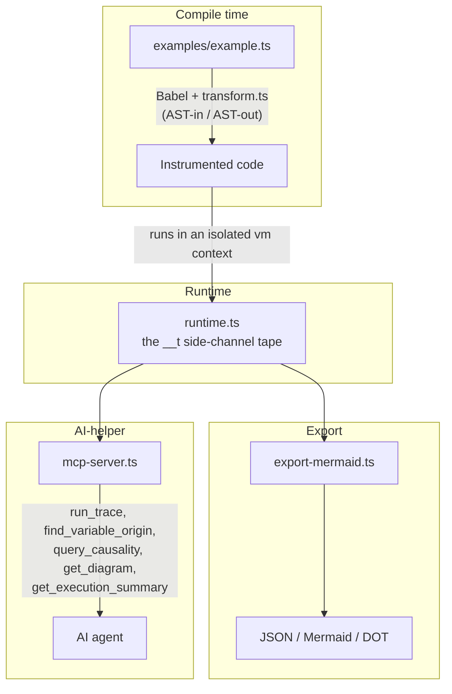

# Mnemosyne

A TypeScript **source-to-source transpiler** that instruments regular TS code to record a
**linear tape** of every operation at runtime, reconstructing the full value-provenance path
across one or more "black box" functions — including internal local/global variable names.

Named after Mnemosyne, the Greek goddess of memory.

> **Debug / reverse-engineering tool only.** Performance is not a goal.

## How it works

JS/TS has no runtime operator overloading, and runtime wrapping cannot see internal variable
names (erased after compilation). Mnemosyne rewrites the **source AST at compile time** so:

- native operators (`+ - * / < >` ...) become traced calls, and
- variable names are read directly from the AST.

Tracing is **side-channel**: the real value flows through unchanged (identical program
results), while each operation records a node into a global tape. We capture a single,
linear, concrete execution path — no speculative branches.

## Architecture

- `src/transform.ts` — Babel plugin (AST-in / AST-out)
- `src/runtime.ts` — the `__t` side-channel tape (builds the DAG)
- `src/export-mermaid.ts` — DAG → JSON + Mermaid diagram / Graphviz DOT
- `src/resolve-module.ts` — resolves a relative import/require specifier to an absolute
  file path; shared by `transform.ts` (compile time) and `module-loader.ts` (run time) so
  both agree on module identity for cross-file provenance edges
- `src/compile.ts` — single shared compile step (instrumented via `transform.ts`, or plain
  via `@babel/plugin-transform-modules-commonjs`) used by both the entry file and any
  locally-imported files
- `src/module-loader.ts` — runtime CommonJS-style loader for local imports; shares one `vm`
  context/tape across every traced file so cross-file dataflow stays in a single DAG
- `src/pipeline.ts` — shared compile+run plumbing (used by both the CLI and the MCP server)
- `src/mcp-server.ts` — MCP server exposing the DAG to an AI agent
- `src/index.ts` — public package entry point (for consumers who just want the Babel
  plugin + runtime tape in their own project)
- `examples/example.ts` — demo with two black boxes (`priceBox`, `labelBox`), chained,
  using `process.env.TAX_RATE` and a module-level `const` to exercise env/constant capture
- `examples/multi-file/` — the same idea split across separate files
  (`price-box.ts`, `label-box.ts`, `main.ts`) connected via relative `import`/`export`, to
  exercise cross-file dataflow tracing



Each stage only knows the shape of what it consumes, not how the upstream one produced it —
the transpiler doesn't know how the tape stores nodes, and the renderer/MCP layer doesn't
know how nodes were produced.

## Running the pipeline

```bash
npm install
npm run trace            # transform + run examples/example.ts, write output/trace.{json,mmd}
npm run trace:multifile  # same, but for examples/multi-file/main.ts (cross-file imports)
```

This runs `examples/example.ts` twice — once plain (types stripped only), once
instrumented — and diffs their `console.log` output to prove the instrumentation is
behavior-preserving, before writing the tape to `output/trace.json` (raw DAG) and
`output/trace.mmd` (Mermaid diagram; paste into <https://mermaid.live>).

Other scripts:

```bash
npm run typecheck   # tsc --noEmit (see note below on memory)
npm run build       # tsc -p tsconfig.json -> dist/
```

> **Note:** `@modelcontextprotocol/sdk`'s tool-registration types combined with zod produce
> very deep generic instantiations that can exceed Node's default heap during type-checking.
> `typecheck`/`build` pass `--max-old-space-size=8192` for this reason. Runtime scripts
> (`trace`, `mcp`) use `ts-node --transpile-only` and are unaffected — they never hit this at
> startup.

## Running the MCP server

```bash
npm run mcp
```

This starts the Mnemosyne MCP server on **stdio**. To register it with an MCP-aware client
(e.g. Claude Code), add it to your MCP config, pointing `command`/`args` at this repo:

```json
{
  "mcpServers": {
    "mnemosyne": {
      "command": "npx",
      "args": ["ts-node", "--transpile-only", "src/mcp-server.ts"],
      "cwd": "/absolute/path/to/mnemosyne"
    }
  }
}
```

Or with the Claude Code CLI:

```bash
claude mcp add mnemosyne -- npx ts-node --transpile-only src/mcp-server.ts
```

### Tools (vocabulary borrowed from [Chronos](https://github.com/Rubentxu/chronos))

| Tool | Purpose |
|------|---------|
| `run_trace` | Run the instrumented example once (optionally overriding env vars, e.g. `{ "TAX_RATE": "0.20" }`); caches the DAG. Call this first. |
| `find_variable_origin` | Given a variable/param name or output attribute (`"total"` or `"priceBox.total"`), return where it was set and its full ancestry. |
| `query_causality` | Trace a value backward (ancestry) or forward (descendants) through the DAG. |
| `get_diagram` | Mermaid diagram — the whole trace, or a sub-graph for one named value. |
| `get_execution_summary` | Inputs, output attributes, black boxes touched, node count. |

Every node carries: internal variable name, scope (`local`/`global`/`param`/`temp`/`const`/
`env`/...), the real runtime value on this run, and the exact source file + line/column.

This is the run-once, low-token AI-helper workflow: an agent calls `run_trace` once, then
answers debugging questions entirely from the cached DAG instead of re-reading and mentally
simulating the source on every question.

## Demo & slides

- `docs/DEMO.md` — a ~10 minute step-by-step walkthrough script (setup → prove behavior
  preservation → read the diagram → drive the MCP server live).
- `docs/presentation/Mnemosyne-Overview.pptx` — a slide deck covering the problem,
  architecture, live example, and roadmap (regenerate with
  `docs/presentation/build_deck.py`).
- `docs/FUTURE-EXTENSIONS.md` — the plan for tracing into external package source instead
  of stopping at the package boundary.

## Scope

See `CLAUDE.md` for the full spec. In scope: binary arithmetic and comparisons, short-circuit
`&& || ??`, generic method calls, function calls, `const`/`let` bindings and simple
assignment, `return` (including per-attribute tracing of object-literal returns),
`process.env.*` / module `const` capture, and local (same-repo) `import`/`export` tracing
across multiple files sharing one tape. Deferred: compound assignment, template literals,
destructuring, spread, `async`/await, loops, tracing into `node_modules`/external packages.

### Known limitation

Provenance across a call boundary is precise for named bindings and params, but coarse for
a bare property read off a black box's returned object (e.g. `priceBox(...).total` used
directly): since values are never wrapped, an object's per-property provenance isn't
attached to the object itself, so such a read resolves to "the object as a whole" rather
than the specific attribute. Binding the property to a local first (as `examples/example.ts`
does with `chainedTotal`) keeps ancestry precise from that point on.

## Using this as a library

`src/index.ts` re-exports `mnemosynePlugin`, the `Tape`/`__t` runtime, `installGlobalTape`,
and the `export-mermaid.ts` helpers (`toJSON`, `toMermaid`, `toDot`, `subgraphFrom`,
`descendantsOf`). `npm run build` compiles to `dist/src/` (`main`/`types` in
`package.json` point there). Published as `@web4w3/mnemosyne` under the MIT license, via
`.github/workflows/publish.yml` — every push to `main` on the (private) source repo builds,
proves behavior preservation, bumps the patch version, and publishes to the public npm
registry. The repo staying private doesn't keep the published package private too: once
published, anyone can `npm install` it and read the compiled output regardless of source
visibility.

> **Note:** esbuild and Babel ship from this one package, not as separate installs. Babel
> (`@babel/*`) is a regular `dependencies` entry — it performs all of the actual AST
> rewriting, on both the plain-Babel-plugin path and the esbuild path below. `esbuild`
> itself is only an *optional* peer dependency: installing `mnemosyne` alone pulls in
> nothing esbuild-related, and only importing the `mnemosyne/esbuild` subpath exercises it.
> There's no separate "esbuild edition" that skips Babel — esbuild has no AST-visitor API of
> its own, so it can only ever be the bundler sitting on top of Babel's rewrite, never a
> replacement for it.

### Bundling with esbuild instead of Babel directly

esbuild has no AST-visitor plugin hook like Babel's — its plugin API only exposes
`onResolve`/`onLoad`. `mnemosyne/esbuild` hooks `onLoad`, runs each matched file through the
same instrumentation `transform.ts` already does, and hands esbuild the already-instrumented
JS to bundle. Babel still performs the actual rewriting; esbuild is just the bundler:

```ts
import * as esbuild from "esbuild";
import { mnemosyneEsbuildPlugin } from "mnemosyne/esbuild";
import { installGlobalTape, __t } from "mnemosyne";

await esbuild.build({
  entryPoints: ["src/app.ts"],
  bundle: true,
  outfile: "out.cjs",
  plugins: [mnemosyneEsbuildPlugin()], // options: { filter?, includeNodeModules? }
});

installGlobalTape(); // instrumented code refers to a free/global `__t` — set it up first
require("./out.cjs");
console.log(__t.nodes.length);
```

## Status

Proof of concept. See `CLAUDE.md` for the full spec and scope.
