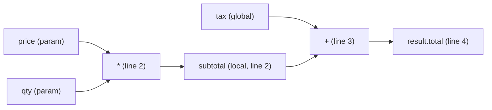

# Mnemosyne — Design & Concept Document

> A TypeScript source-to-source transpiler that reconstructs the full value-provenance
> path of a computation — across one or more "black box" functions — including the names
> of internal local and global variables.
>
> **Purpose:** reverse-engineering, debugging, and calculation-flow visualization.
> **Explicit non-goal:** production performance.

---

## 1. Executive summary

Modern business logic is often a chain of opaque functions ("black boxes") that transform
inputs into an output structure. When something is wrong — a bad total, a mangled string,
an unexpected date — engineers must manually trace *how* each output value was produced and
*from which inputs*. Mnemosyne automates that: it rewrites ordinary TypeScript so that, when
it runs, it records a **linear tape** of every operation actually executed, then renders that
tape as a **value-provenance diagram** (a DAG). Each node in the diagram is an operation or a
named variable; each edge shows where a value came from. You can point at any output attribute
and walk backward to the original inputs, through every intermediate step — including the
temporary local and global variables the original programmer used.

The key insight: what is **impossible at runtime** in JavaScript/TypeScript (operator
overloading, seeing internal variable names) becomes **straightforward at compile time** by
transforming the source AST.

---

## 2. Problem statement

Given one or more black-box functions where:

- inputs are a variable set of arguments (mixed types, variable count),
- outputs are a variable set of values / a structure with many attributes,
- outputs of one black box may feed the inputs of another,
- operations span **numbers** (`+ - * /`), **comparisons** (`< > <= >= === !==`),
  **strings** (`concat`, `split`, `trim`, ...), **booleans**, and **dates**,
- complex types implement method analogs of operators (`add`, `extract`, `multiply`, `divide`),

**reconstruct the entire calculation path** from the outputs, and present it visually so a
human can see exactly which inputs and intermediate steps produced each result — including
the internal variable names used inside each black box.

---

## 3. Landscape — what already exists

The general technique is called **tracing via operator overloading** (Python) or, more
broadly, **program instrumentation / provenance tracking**. Mnemosyne's contribution is not
inventing the idea — it is bringing a **name-preserving, compile-time** variant to TypeScript.

### 3.1 Python libraries (mature prior art)

| Library / Tool | What it does | Mechanism | Relevance |
|----------------|--------------|-----------|-----------|
| **JAX** (`jax.make_jaxpr`) | Traces a numeric function into a **jaxpr** IR — a fully inspectable list of primitive operations. | Pass-in `Tracer` objects overload every primitive op. | Gold standard for "reconstruct the path"; numeric only, invents its own variable names. |
| **Autograd** (HIPS) | Records ops onto a **tape** (Wengert list) for automatic differentiation. | `Box` wrapper overloads operators. | Closest to a hand-rolled tracer; pure Python, hackable. |
| **PyTorch autograd** | Every `Tensor` carries a `grad_fn` graph — the full DAG that produced it. | Operator overloading + dynamic graph. | Industrial-scale DAG-from-output. |
| **TensorFlow** (`tf.function`, autograph) | Traces Python into a `GraphDef` computation graph. | Tracing + graph capture. | Static graph IR. |
| **SymPy** | Native operators on `Symbol` objects build a symbolic **expression tree** you can print, simplify, walk. | Operator overloading. | Best for algebraic (single-expression) reconstruction. |
| **Theano** (deprecated), **SageMath** | Symbolic/graph computation. | Operator overloading. | Historical reference. |
| **`uncertainties`** | Propagates error bars by overloading operators; carries lineage. | Operator overloading. | Shows lineage-carrying values. |
| **`unittest.mock` / `wrapt`** | Record attribute access & method calls; build transparent proxies. | Proxy objects. | Method-call recording pattern. |

**Key limitation of all Python options:** they record their *own* built-in operations and
invent their *own* variable names. None recovers the **original source variable names** of an
arbitrary function, and none traces native operators in a language that lacks operator
overloading (like TS).

### 3.2 Data-lineage / provenance systems (cross-"box" prior art)

| Tool | Domain | Relevance |
|------|--------|-----------|
| **OpenLineage**, **Apache Atlas**, **Marquez** | Data-pipeline lineage | Track values flowing through transformation stages across many "boxes"; column-level lineage is conceptually identical to our cross-black-box DAG. |
| **Apache Spark / dbt** | ETL lineage | Same idea at dataset/column granularity. |
| **Symbolic execution** (angr, KLEE) | Security / analysis | Track operations across all types including comparisons and control flow. |
| **Taint analysis** | Security | Follows data provenance through arbitrary operations. |

### 3.3 Instrumentation / AST-rewriting prior art (the technique Mnemosyne uses)

| Tool | What it does | Relevance |
|------|--------------|-----------|
| **Babel** (`@babel/core`, `traverse`, `generator`) | The JS/TS AST transform ecosystem. | Our transpiler engine; `path.scope` yields variable names & binding kinds. |
| **Istanbul / c8 / `babel-plugin-istanbul`** | Rewrite source to record which lines/branches ran (coverage). | **Exact same technique**, applied to coverage instead of dataflow — the canonical reference. |
| **iroh.js** | Runtime JS analysis via self-instrumentation; observe execution. | Closest existing JS tool to Mnemosyne. |
| **TypeScript Compiler API / ts-morph** | Programmatic AST read/write with full type info. | Alternative engine if we later need type data in the trace. |

### 3.4 Why not just reuse one of these?

- **Language gap:** JAX/Autograd/SymPy are Python and rely on operator overloading. TS has
  none — so their core mechanism does not port.
- **Custom operations:** the black boxes use bespoke method analogs (`add`/`extract`/
  `multiply`/`divide`) that no off-the-shelf tracer knows.
- **Internal variable names:** *no* existing tool recovers the original internal local/global
  names of an arbitrary function. This is Mnemosyne's differentiator, and it is only
  achievable by reading the source AST at compile time.

---

## 4. Why TypeScript makes this hard (and how we solve it)

| Capability | Python | TypeScript (runtime) | Mnemosyne (compile-time) |
|------------|--------|----------------------|--------------------------|
| Trace native `+ - * / < >` | ✅ operator overloading | ❌ **impossible** | ✅ rewrite `a + b` → `__t.op('+', a, b, …)` |
| Trace method calls (`.trim()`, `.add()`) | ✅ | ✅ via `Proxy` | ✅ rewrite to `__t.call(...)` |
| Recover **internal variable names** | ❌ (invents names) | ❌ **erased after compile** | ✅ read identifier from AST |
| Source location (line/col) | partial | ⚠️ stack hacks only | ✅ exact, from AST |
| Global / temp variables | — | ❌ invisible | ✅ visible via assignment nodes + `path.scope` |

**The core realization:** operator overloading and variable-name recovery are impossible at
*runtime* in JS/TS, but both fall out naturally when you transform the *source* before it runs.
The AST still literally contains `const subtotal = a * b` — the name `subtotal`, the operator
`*`, and the line number are all right there.

---

## 5. The Mnemosyne approach

### 5.1 Side-channel, linear tracing (the chosen model)

Two tracing strategies exist:

- **Value-wrapping:** replace each value with a wrapper object carrying an id. Clean graph
  identity, but risks "unwrap leaks" (if a black box coerces the wrapper to a raw primitive,
  the trace breaks silently) and can subtly change behavior.
- **Side-channel (CHOSEN):** the **real value flows through unchanged**; each operation
  records a node into a **global tape** as a side effect and tags the produced value with a
  lightweight id. The program's results are **identical** to the original.

We chose **side-channel** deliberately: we want **linear calculations** — the operations that
*actually executed*, in order, with **no speculative branches and no "possible" deviations**.
The tape reflects exactly one concrete execution path. This is the correct model for
debugging and reverse-engineering a specific run.

### 5.2 What gets recorded

Each tape node stores:

```
{
  id,          // unique node id
  kind,        // 'input' | 'op' | 'call' | 'bind' | 'return'
  op,          // e.g. '+', '<', 'trim', 'multiply'
  label,       // human name: variable name, param name, or output attribute
  inputs: [],  // ids of parent nodes (the DAG edges)
  value,       // the actual runtime value on this run (side-channel snapshot)
  scope,       // 'local' | 'global' | 'param' | 'temp'
  loc          // source file, line, column
}
```

Chaining black boxes chains the DAG automatically: box B's inputs are box A's output nodes.

### 5.3 Rewrite mapping

| Source | Rewritten to |
|--------|--------------|
| `a + b` | `__t.op('+', a, b, {loc, lhs:'a', rhs:'b'})` |
| `a < b` | `__t.op('<', a, b, {...})` |
| `s.trim()` | `__t.call(s, 'trim', [], {...})` |
| `const total = x` | `const total = __t.bind('total', x, {scope, loc})` |
| `f(x, y)` | `__t.call(null, f, [x, y], {fn:'f', argNames:['x','y']})` |
| `return r` | `return __t.ret('f', r)` |

---

## 6. Pros and cons of the new approach

### 6.1 Pros

- **Recovers internal variable names** — local, global, and temporary. This is the standout
  capability no runtime tracer or existing library provides for arbitrary code.
- **Traces native operators** (`+ - * / < >`) that TS cannot intercept at runtime.
- **Exact source locations** (file / line / column) for every operation — click a node, jump
  to the code.
- **Cross-black-box provenance** — one DAG spans the whole pipeline; each output attribute
  walks back to original inputs.
- **Type-agnostic** — numbers, strings, booleans, dates, and complex custom types are all just
  "operation nodes"; more types simply mean richer labels.
- **Behavior-preserving** — side-channel means results are identical to the original program;
  safe to run on real code paths.
- **No source-of-truth drift** — instrumentation is generated from the real source, so it
  cannot disagree with what the code actually does.
- **Great for onboarding & audits** — the flow diagram doubles as living documentation of how
  a result is computed.
- **Language-appropriate** — leans on Babel, the standard, battle-tested JS/TS AST toolchain
  (same technique as code-coverage tools).

### 6.2 Cons / limitations (be honest)

- **Performance overhead** — every operation becomes a function call plus a tape write.
  Acceptable because it is a debug / RE-only tool, not for production.
- **Single execution path only** — the tape captures *this* run, not all possible branches.
  (This is intentional for linear reconstruction, but must be communicated clearly.)
- **Expression-coverage breadth** — TS has many node kinds; the PoC covers a subset. Full
  coverage (compound assignment, destructuring, template literals, spread, async forms beyond
  named async function declarations with basic `await`) is
  incremental "breadth work."
- **The two genuinely hard parts:**
  1. **Faithful lowering of side-effecting & short-circuit expressions** (`&& || ?? ?:`,
     `a() + b()`) — must preserve left-to-right evaluation order and never double-evaluate.
     (Deferred in the PoC.)
  2. **Node-identity model** — deciding when two values are "the same" node (value-based vs.
     binding-based), especially with aliasing (`let x = y`) and in-place mutation.
- **Requires source access** — by definition this instruments source, so a truly compiled /
  minified black box with no source is out of scope (names would be lost).
- **Loops produce repeated nodes** — need per-iteration ids or aggregation for readability
  (deferred).
- **Not a substitute for a type checker** — Babel ignores types; if type-level provenance is
  needed later, we would add the TS Compiler API.

---

## 7. Proof of Concept (PoC)

### 7.1 Goal

Trace a small **two-black-box** example end to end and render a value-provenance diagram —
proving the pipeline (transform → run → export) works and that **internal variable names**
appear correctly.

### 7.2 Tooling

- **Babel** (`@babel/core`, `parser`, `traverse`, `generator`, `preset-typescript`).
  Chosen because `path.scope` gives binding classification (local / global / param / temp) and
  variable names for free; no type checker needed for the PoC.
- **TypeScript** for the runtime tape and exporter. **Node.js** to run.

### 7.3 Architecture — three decoupled components

1. **`src/transform.ts`** — Babel plugin. Pure AST-in / AST-out. Visitors for
   `BinaryExpression`, `CallExpression`, `VariableDeclarator`, `AssignmentExpression`,
   `ReturnStatement`. Rewrites nodes to `__t.*` calls, injecting `{ name, scope, loc }` from
   `path.scope` and `node.loc`.
2. **`src/runtime.ts`** — the `__t` side-channel tape: `op()`, `call()`, `bind()`, `ret()`.
   Assigns ids, records nodes into an in-memory DAG, passes the real value straight through.
3. **`src/export-mermaid.ts`** — serialize the DAG to JSON and emit a Mermaid diagram (and
   optionally Graphviz DOT).

### 7.4 In scope / deferred

- **In:** `+ - * /`; `< > <= >= === !==`; generic `obj.method(args)`; `f(x, y)` with arg-name
  capture; `const`/`let` + simple assignment with name + scope capture; `return`; one linear
  execution path.
- **Deferred:** short-circuit `&& || ?? ?:`; compound assignment / unary / template literals /
  destructuring / spread; async arrows and methods / generators; loops/aggregation; optional chaining.
- **Basic `await` support:** named async function declarations detach their tape frame while
  suspended and restore it before the continuation, so synchronous work between awaits keeps
  resolving against its own scope. Async arrows, methods, and uncaught async rejection frame
  cleanup remain outside this limited support.

### 7.5 How it works, step by step

1. **Parse** `example.ts` into an AST (Babel).
2. **Transform** — visitors replace operators, calls, bindings, and returns with `__t.*`
   calls carrying source metadata (names, scope, line/col).
3. **Generate** instrumented code (`@babel/generator`) + source map.
4. **Run** the instrumented code. Values compute normally; each op writes a node to the tape.
5. **Export** — the tape (now a DAG) is serialized to JSON and rendered to Mermaid.
6. **Inspect** — the diagram shows every input, internal variable, operation (with line), and
   output attribute, across both black boxes.

### 7.6 Example (illustrative)

Source:

```ts
function priceBox(price: number, qty: number) {
  const subtotal = price * qty;
  const total = subtotal + tax;      // tax is a global
  return { total };
}
function labelBox(first: string, last: string) {
  const name = first.trim() + " " + last.trim();
  return { name };
}
```

Reconstructed flow (Mermaid, illustrative):



Note the presence of `subtotal` (internal local) and `tax` (global) as first-class,
named nodes — the capability that distinguishes Mnemosyne.

### 7.7 Success criteria

- Instrumented `example.ts` produces **identical** results to the original.
- The trace correctly names **inputs, internal locals, and output attributes**.
- The Mermaid diagram shows the full linear path across **both** black boxes, each op labeled
  with operation + source line.

---

## 8. Roadmap beyond the PoC

1. Short-circuit & side-effect lowering (`&& || ?? ?:`, sequenced calls).
2. Full expression coverage (compound assignment, unary, templates, destructuring, spread).
3. Loop handling (per-iteration nodes or aggregation).
4. Interactive HTML viewer (click node → value, source, ancestors).
5. Optional TS Compiler API integration for type-level provenance.
6. Multi-file / module-boundary tracing.
7. Diff mode: compare two runs' provenance to localize a regression.

---

## 9. Audience-specific framing (for the presentations)

### For developers
- It's Babel instrumentation (same technique as Istanbul coverage). Side-channel tape, linear
  trace. You get exact source lines and **internal variable names** in a clickable DAG.
- Emphasize: the two hard parts (short-circuit lowering, node identity) and the deferred scope.

### For architects
- A decoupled 3-stage pipeline (transform / runtime tape / exporter). Language-appropriate
  choice of Babel over runtime Proxy because TS lacks operator overloading and erases names.
- Positions cleanly next to data-lineage systems (OpenLineage/Atlas) but at expression
  granularity within code. Debug/RE-only; not on the production hot path.

### For managers
- Cuts the time to answer "where did this wrong value come from?" from hours of manual tracing
  to a single diagram. Improves debugging, audits, onboarding, and regulatory explainability
  ("show how this number was calculated"). Low risk: results are unchanged; it's a read-only
  lens over existing code.

---

## 9a. Related work — AI-helper / token-reduction positioning

Mnemosyne's most compelling use case is as an **AI helper served over MCP**: run the
instrumented code **once**, then let an AI agent query a compact **value-provenance diagram**
(internal variable names, env vars / constants, real runtime values, exact source line per
operation) instead of tokenizing thousands of lines of source and mentally simulating
execution. Research into existing tools shows two adjacent camps — and a gap Mnemosyne fills.

### Camp A — Runtime execution-trace MCP servers (dynamic, but not dataflow-shaped)

| Tool | What it does | Gap vs. Mnemosyne |
|------|--------------|-------------------|
| **Chronos** (`Rubentxu/chronos`) | Time-travel-debugging MCP server; turns execution into a **queryable temporal database** for AI agents. Tools: `find_variable_origin`, `query_causality`, `reconstruct_call_stack`, `compare_sessions`. Multi-language (Python `sys.settrace`, native ptrace, Java JDWP, Go Delve). | **Closest prior art.** But it is event/stack/query oriented, not a holistic value-provenance **diagram**; no internal-name + env/constant + expression-granularity DAG. |
| **mcp-debugger** (`debugmcp/mcp-debugger`) | Headless debugger over MCP (DAP); agents set breakpoints, inspect variables, step, 7 languages. | Breakpoint/step model, not a dataflow diagram; agent drives it interactively. |
| **Undo UDB × MCP**, **PMAT time-travel**, **otel-mcp**, **vigilante** | Feed runtime traces / OTel spans to AI agents. | Observability/trace events, not expression-level value provenance. |

### Camp B — Static code-graph tools for token reduction (validates the thesis)

| Tool | What it does | Gap vs. Mnemosyne |
|------|--------------|-------------------|
| **Graphify**, **CodeGraph**, **code-review-graph** | Pre-index a repo into a queryable knowledge/dependency graph so agents retrieve targeted context instead of reading whole files. Reported **~70% token cuts**. | **Static** — no real runtime values, no actual executed path, no env/constant values. |
| **CntxtJS / CntxtCS** (`brandondocusen`) | Generate code knowledge graphs for LLM context (JS/TS, C#). | Structural, not executional. |
| **"Stingy Context"** (arXiv 2601.19929) | Hierarchical tree compression; **18:1** context reduction (239k→11k tokens). | Compression of source, not dynamic provenance. |
| **LLMDFA** (arXiv 2402.10754) | LLM-powered dataflow analysis without compilation. | Analysis technique, not a run-once provenance diagram. |

### The gap Mnemosyne fills

| Capability | Camp A | Camp B | **Mnemosyne** |
|------------|:-----:|:-----:|:-------------:|
| Runtime *actual values* | ✅ | ❌ | ✅ |
| **Internal variable names** | partial | ✅ (static) | ✅ (from AST) |
| Env vars / constants captured | ❌ | ❌ | ✅ (side-channel) |
| Exact source line per operation | partial | ✅ | ✅ |
| Value-provenance **diagram** | ❌ (event/stack) | ✅ (structural) | ✅ (executional) |
| Single linear concrete path | ✅ | ❌ | ✅ |
| Run-once → AI queries via MCP (token saver) | ✅ | ✅ | ✅ (design goal) |
| Cross-black-box provenance at expression granularity | ❌ | partial | ✅ |

**Unfilled niche:** a **run-once, side-channel transpiler** that emits a value-provenance
diagram (internal variables, env/constants, real values, source lines) served to an AI over
**MCP**, so the agent reads a compact diagram instead of tokenizing and simulating source.

### Token-reduction thesis (validated by Camp B)

Teams report **~70%** token cuts and up to **18:1** compression by giving LLMs a graph instead
of raw code. Mnemosyne's twist — a *dynamic, execution-derived* graph with **real values** —
is stronger for debugging / complex-logic questions because the agent does not have to
*simulate* the code in its head (expensive, error-prone); it reads the already-executed truth.

### Actionable direction

1. **Add an MCP server as a first-class component** — run instrumented code once; expose the
   DAG as queryable tools plus a rendered diagram. This is the AI-helper story.
2. **Borrow Chronos's tool vocabulary** — `find_variable_origin`, `query_causality`,
   `compare_sessions` are proven MCP tool shapes; differentiate on diagram + internal-names +
   env/constants + expression granularity.
3. **Use Camp B's numbers** (~70% / 18:1) as market validation in the manager/architect pitch.

## 10. References

- JAX tracing / jaxpr — https://jax.readthedocs.io
- Autograd (HIPS) — https://github.com/HIPS/autograd
- PyTorch autograd — https://pytorch.org/docs/stable/autograd.html
- SymPy — https://www.sympy.org
- Babel — https://babeljs.io
- Istanbul / `babel-plugin-istanbul` — https://github.com/istanbuljs
- iroh.js — https://github.com/maierfelix/iroh
- ts-morph — https://ts-morph.com
- TypeScript Compiler API — https://github.com/microsoft/TypeScript/wiki/Using-the-Compiler-API
- OpenLineage — https://openlineage.io
- Apache Atlas — https://atlas.apache.org
- Chronos (time-travel debugging MCP) — https://github.com/Rubentxu/chronos
- mcp-debugger — https://github.com/debugmcp/mcp-debugger
- CntxtJS (LLM code knowledge graphs) — https://github.com/brandondocusen/CntxtJS
- LLMDFA (LLM dataflow analysis) — https://arxiv.org/abs/2402.10754
- Undo UDB × MCP — https://undo.io/resources/time-travel-ai-code-assistant/
