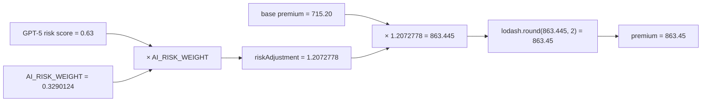

# Production incident: insurance premium increased unexpectedly

> Demonstration scenario based on the insurance-premium example. The MCP outputs below are a deterministic, illustrative incident fixture formatted to match Mnemosyne's current tools; they are not a transcript from a live MCP server run. The currently configured MCP trace still runs the default example, and some result tools accept numeric node IDs rather than the `premium` label.

## Incident report

At 09:14 ET, underwriting support reported that an otherwise standard New Jersey application was quoted at **$863.45**. The expected premium from the approved pricing sheet was **$715.20**. The application was approved, but the customer-facing premium was 20.73% higher than expected.

The traced run uses the same application as the flagship demo and a deterministic AI fixture: `openai / gpt-5` returns risk score `0.63` and reports 123 tokens. For this incident fixture, the pre-AI premium is `$715.20`. Production configuration supplied `AI_RISK_WEIGHT=0.3290124`, while the approved pricing configuration is `0`. With the formula `riskAdjustment = 1 + aiRisk * AI_RISK_WEIGHT`, the runtime trace records:

```text
715.20 × (1 + 0.63 × 0.3290124)
≈ 715.20 × 1.2072778
≈ 863.445 before currency rounding
```

For this fixture the recorded pre-round value is `863.445`, and `lodash.round(863.445, 2)` returns `$863.45`. The production defect is the incorrect runtime weight, not an unexpected package result or a model response outside the captured range.

## 1. Provenance graph traversal

First locate the result node, then walk its ancestry. The production MCP tool currently calls this `find_variable_origin` or `query_causality`; the command syntax below uses the observed `premium` result label. For the live numeric-ID schema, substitute the `premium` node ID returned by `find_variable_origin`.

```text
find_variable_origin(name="premium")
```

```json
{
  "target": {
    "id": 61,
    "kind": "bind",
    "label": "premium",
    "value": 863.45,
    "inputs": [60]
  },
  "ancestry": [
    { "id": 3, "kind": "input", "label": "vehicleValue", "value": 45000 },
    { "id": 7, "kind": "package", "label": "lodash.round", "value": 715.2,
      "package": { "packageName": "lodash", "version": "4.17.21", "functionName": "round" } },
    { "id": 24, "kind": "input", "label": "process.env.AI_RISK_WEIGHT", "value": "0.3290124" },
    { "id": 39, "kind": "ai", "label": "openai.gpt-5", "value": { "riskLevel": "medium", "score": 0.63 },
      "ai": { "provider": "openai", "model": "gpt-5", "tokens": 123 } },
    { "id": 43, "kind": "op", "label": "*", "value": 0.2072778, "inputs": [39, 24] },
    { "id": 46, "kind": "op", "label": "+", "value": 1.2072778, "inputs": [43] },
    { "id": 55, "kind": "op", "label": "*", "value": 863.445, "inputs": [7, 46] },
    { "id": 60, "kind": "package", "label": "lodash.round", "value": 863.45,
      "package": { "packageName": "lodash", "version": "4.17.21", "functionName": "round" } },
    { "id": 61, "kind": "bind", "label": "premium", "value": 863.45, "inputs": [60] }
  ],
  "note": "Compact incident excerpt; intermediate nodes omitted for readability."
}
```

The key evidence is in the executed values: the base premium is `$715.20`; the environment input is `0.3290124`; the AI node contributes `0.63`; the risk multiplier becomes `1.2072778`; the final package call rounds `863.445` to `$863.45`.



## 2. Package investigation

```text
get_package_usage(packageName="lodash")
```

```json
{
  "packageName": "lodash",
  "callCount": 2,
  "nodes": [
    { "id": 7, "label": "lodash.round", "inputs": [6, 2], "value": 715.2,
      "package": { "packageName": "lodash", "version": "4.17.21", "functionName": "round", "executionTimeMs": 0 } },
    { "id": 60, "label": "lodash.round", "inputs": [59, 2], "value": 863.45,
      "package": { "packageName": "lodash", "version": "4.17.21", "functionName": "round", "executionTimeMs": 0 } }
  ]
}
```

Both package calls received the expected scale argument and returned the expected rounding of their input. This trace does not point to lodash as the source of the premium increase. The package is a visible calculation participant, but its node is a black box; this call-level evidence does not inspect lodash internals.

## 3. AI influence investigation

```text
get_ai_nodes(provider="openai", model="gpt-5")
```

```json
{
  "provider": "openai",
  "model": "gpt-5",
  "callCount": 1,
  "nodes": [
    { "id": 39, "kind": "ai", "label": "openai.gpt-5",
      "value": { "riskLevel": "medium", "score": 0.63 },
      "inputs": [35],
      "ai": { "provider": "openai", "model": "gpt-5", "tokens": 123,
        "temperature": 0, "executionTimeMs": 842, "metadata": { "purpose": "insurance-risk-assessment" } } }
  ]
}
```

The AI call is causally upstream of the premium because its score is consumed by the risk adjustment. The score is `0.63`, below the manual-review threshold of `0.8`, so it did not change the approval status. The trace shows that the score was multiplied by the configured weight; the model itself did not produce `$863.45`.

## 4. Dependency analysis

```text
query_causality(name="premium", direction="backward")
```

```json
{
  "target": { "id": 61, "label": "premium", "value": 863.45 },
  "dependencySummary": {
    "packages": [
      { "packageName": "lodash", "version": "4.17.21", "callsInAncestry": 2 }
    ],
    "aiCalls": [
      { "provider": "openai", "model": "gpt-5", "nodeId": 39, "score": 0.63 }
    ],
    "runtimeConfiguration": [
      { "name": "AI_RISK_WEIGHT", "value": "0.3290124", "nodeId": 24 }
    ]
  }
}
```

The premium depends on two distinct kinds of external participants: package rounding and the AI risk score. It also depends on a runtime configuration value. That third dependency is the differentiator in this incident: it is visible in the same ancestry as the value it changed.

## 5. Root cause and resolution

The root cause is `AI_RISK_WEIGHT=0.3290124` in the production environment. The approved pricing setting for this flow is `0`. The trace makes the causal path explicit:

```text
AI score 0.63
  × runtime weight 0.3290124
  + 1
  = 1.2072778 risk multiplier
  × base premium $715.20
  = $863.445
  → lodash.round(..., 2)
  = $863.45
```

The immediate remediation is to correct the environment value and rerun the same application. For the controlled incident fixture, setting the weight to `0` removes this extra uplift and returns the pre-AI premium of `$715.20`. A follow-up change should validate `AI_RISK_WEIGHT` against the approved range at startup and record the selected rating configuration as an explicit named input.

### Why this investigation is faster

| Approach | What it can establish | What it misses in this incident |
|---|---|---|
| Source review | The intended formula and where configuration is read | Which runtime value actually entered the executed calculation, which branch ran, and which output consumed it |
| Log analysis | The final quote and perhaps selected debug messages | A complete value-by-value ancestry. Logs often omit intermediate multipliers and package call inputs/outputs |
| AI code inspection | A likely explanation from source and context supplied to the model | Ground truth for this execution. Without the trace, the model could blame GPT-5 or lodash based on plausibility rather than observed values |
| Mnemosyne MCP | Concrete runtime values and edges from the premium back to package calls, AI output, and environment input | It still describes only the instrumented run and supported syntax; it does not prove behavior on unexecuted paths |

Mnemosyne does not replace code review or logs. It supplies the missing runtime explanation: which values actually flowed into this specific premium and how they combined.
